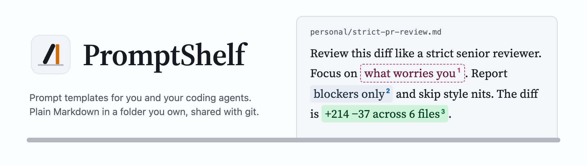
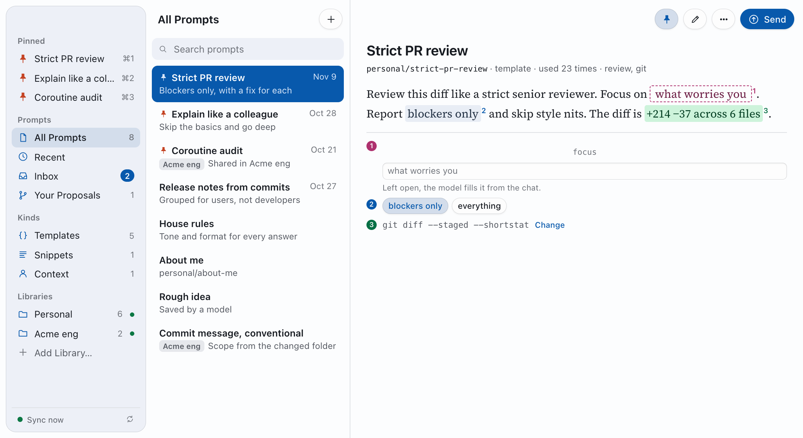
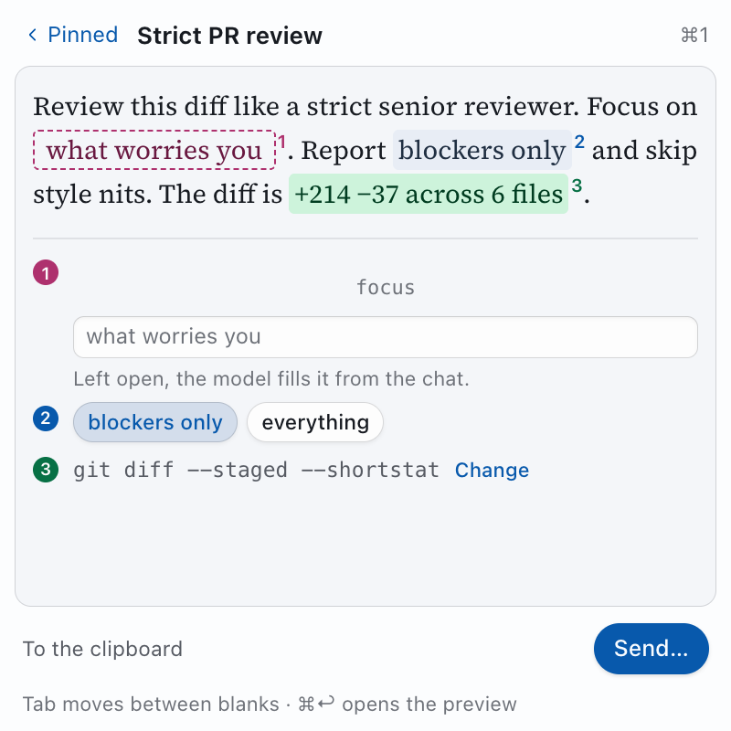

<picture>
  <source media="(prefers-color-scheme: dark)" srcset="docs/images/header-dark.png" />
  
</picture>

[](https://crates.io/crates/promptshelf)
[](https://github.com/ETSoftwareStudio/promptshelf/releases/latest)
[](https://github.com/ETSoftwareStudio/promptshelf/actions/workflows/ci.yml)
[](LICENSE)

A local-first library to save, template, reuse and share prompts. Prompts are Markdown files in a folder you own, synced with git. The `shelf` command finds and fills them, for you and for coding agents.

<picture>
  <source media="(prefers-color-scheme: dark)" srcset="docs/images/app-dark.png" />
  
</picture>

Each blank shows where its value comes from. Rose means the model fills it from the chat. Blue is a value you chose. Green comes from your repo or a command.

## What it has
- **`shelf` CLI** — Search, show and fill prompts. Every command has `--json` output for agents.
- **Terminal app** — Run `shelf` with no arguments.
- **Desktop app** — macOS, Windows and Linux, with a tray panel and a global shortcut. Everything works from the app: set up, add team libraries, sync, propose changes and connect agents, with no terminal.
- **Agents** — A Claude Code skill, and `shelf mcp` for apps with no shell.
- **Sync and sharing** — Plain git. No server, no account, no telemetry.

The tray panel opens with a global shortcut and fills a prompt without leaving your app.

<picture>
  <source media="(prefers-color-scheme: dark)" srcset="docs/images/panel-dark.png" />
  
</picture>

## Set up with an AI agent
Copy one of these prompts into your coding agent (Claude Code, Codex, Cursor and others). The agent follows the linked steps. It asks you before the steps that need you, such as creating your library.

Install PromptShelf:
```text
Install PromptShelf for me. Follow the steps in
https://raw.githubusercontent.com/ETSoftwareStudio/promptshelf/main/docs/agents/install.md
```

Connect it to an app over MCP (Claude Desktop, Cursor, VS Code and others):
```text
Connect PromptShelf to my apps over MCP. Follow the steps in
https://raw.githubusercontent.com/ETSoftwareStudio/promptshelf/main/docs/agents/mcp.md
```

Agents that read [`llms.txt`](llms.txt) get a short summary and links to both.

## Install
```sh
brew install etsoftwarestudio/tap/promptshelf   # macOS and Linux
cargo install --locked promptshelf              # any system with Rust
npx promptshelf-cli --help                      # try it without installing
```

Binaries for macOS, Linux and Windows are on the [releases page](https://github.com/ETSoftwareStudio/promptshelf/releases/latest).

Each install puts two commands on your PATH: `shelf`, and `promptshelf` for systems where another tool owns `shelf`. The npm package is named `promptshelf-cli`, and it adds a third command with that name so `npx` can run it.

### Desktop app
```sh
brew install --cask etsoftwarestudio/tap/promptshelf-app   # macOS
```

Installers for macOS (`.dmg`), Windows (`.exe` and `.msi`) and Linux (`.AppImage` and `.deb`) are on the [releases page](https://github.com/ETSoftwareStudio/promptshelf/releases/latest).

The macOS app is signed with a Developer ID and notarised by Apple. The Windows installers are not signed yet, so the first launch shows "Windows protected your PC". Click More info, then Run anyway.

## Use
```sh
shelf init                          # create ~/Prompts/personal
shelf new "Strict PR review"        # write a prompt in $EDITOR
shelf                               # the terminal app: search, fill, copy
shelf fill strict-pr-review --var focus="error handling"
```

### Teach your agents the commands
```sh
npx skills add ETSoftwareStudio/promptshelf -g
```

[skills.sh](https://skills.sh) installs the PromptShelf skill for each agent you pick, such as Claude Code, Codex and Cursor. It keeps one copy and links each agent to it. To get a newer version later, run `npx skills update -g`.

With no Node.js, run `shelf skill install`. It writes the skill for Claude Code only.

Every command takes `--json`. Agents with no terminal can read, fill and save drafts; other writes need a person.

### Apps with no shell (MCP)
`shelf mcp` serves the Model Context Protocol on stdio. Templates show up as prompts, and four tools search, show, fill and save drafts. For Claude Desktop, add this to `claude_desktop_config.json`:

```json
{ "mcpServers": { "promptshelf": { "command": "shelf", "args": ["mcp"] } } }
```

It runs only while the app runs: no daemon and no network port.

Use the full path to `shelf` (`command -v shelf`): apps started from the Dock often do not see your terminal's PATH. [docs/agents/mcp.md](docs/agents/mcp.md) has the settings for Claude Code, Cursor, VS Code and Codex.

## Build
```sh
cargo build
cargo test
```

The workspace has two crates:

| Crate | What it is |
| --- | --- |
| `crates/promptshelf-core` | The library: prompt files, templates, libraries, sync |
| `crates/promptshelf` | The `shelf` command (also installed as `promptshelf`) |

The desktop app is in `app/`, outside the workspace. See [app/README.md](app/README.md).

The Raycast extension is in [`raycast/`](raycast/README.md). It calls `shelf --json`.

## Licence
MIT. See [LICENSE](LICENSE).
