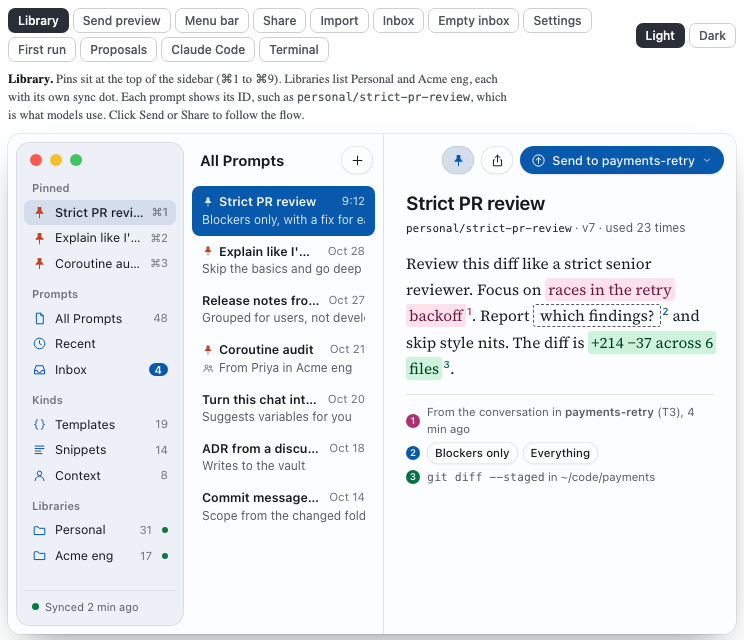
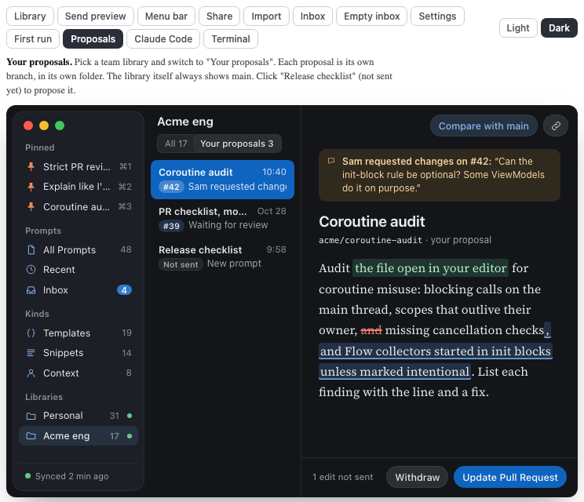

# PromptShelf: brand

How it looks and sounds. It follows the studio's design rules: OKLCH colours, no AI look. The direction is chosen ([0004](../decisions/0004-margin-as-the-visual-direction-for-the-mac-app.md)). The palette passes the studio's colour rule since the re-tint on 2026-11-01.

## Files
| Folder | Contents |
| --- | --- |
| `margin-full.html` | The prototype. Open it in a browser. Data in it is made up. |
| `screenshots/` | Every screen of `margin-full.html`, light and dark, 744 × 640. Raycast screens use a neutral Raycast-like window, not the Margin chrome. |
| `logo/` | App icon and logo. None yet. |

## Mockups
Built in a scratch project with the [impeccable](https://impeccable.style) method. The [exploration report](../exploration-and-design.md) explains each step.

**Main reference:** [`margin-full.html`](margin-full.html). One tab per screen, plus a Light/Dark switch. Arrow keys move between tabs. Deep links open a screen: `margin-full.html#proposals,dark`, `#propose,light`.

The earlier explorations are not in this repo. They are listed here as history.

| Exploration | What it shows | Status |
| --- | --- | --- |
| `promptlib.html`, `sharing.html` | First look: dark Linear/Raycast style | Rejected |
| `directions.html` | Terminal, reference book, "the prompt is the form", menu bar | Terminal and menu bar kept |
| `context-fill.html` | Filling from context and Send | Led to decision 0002 |
| `native-directions.html` (and `native-1.html` to `native-3.html`) | Margin, Ledger, Outbox | Margin chosen |
| `margin-pins-sync.html` | Pins, Settings → Library, menu bar | Superseded by `margin-full.html` |
| `margin-options.html` | Source colours 1A/1B, Send 2A/2B | 1B and 2B chosen |
| `margin-screens-1.html`, `margin-screens-2.html` | Quick fill, preview, Share, import, Inbox, empty states | Superseded by `margin-full.html` |

## Screens
From `margin-full.html`. Light first, dark second.

| Screen | Light | Dark |
| --- | --- | --- |
| Library: pins, libraries, a prompt with tinted values and footnotes | [light](screenshots/library-light.png) | [dark](screenshots/library-dark.png) |
| Send preview | [light](screenshots/send-light.png) | [dark](screenshots/send-dark.png) |
| Menu bar | [light](screenshots/menubar-light.png) | [dark](screenshots/menubar-dark.png) |
| Menu bar: quick fill | [light](screenshots/menubar-fill-light.png) | [dark](screenshots/menubar-fill-dark.png) |
| Menu bar: preview | [light](screenshots/menubar-preview-light.png) | [dark](screenshots/menubar-preview-dark.png) |
| Share | [light](screenshots/share-light.png) | [dark](screenshots/share-dark.png) |
| Import review | [light](screenshots/import-light.png) | [dark](screenshots/import-dark.png) |
| Inbox | [light](screenshots/inbox-light.png) | [dark](screenshots/inbox-dark.png) |
| Empty Inbox | [light](screenshots/inbox-empty-light.png) | [dark](screenshots/inbox-empty-dark.png) |
| Settings → Libraries | [light](screenshots/settings-light.png) | [dark](screenshots/settings-dark.png) |
| Settings → Agents | [light](screenshots/settings-agents-light.png) | [dark](screenshots/settings-agents-dark.png) |
| First run | [light](screenshots/firstrun-light.png) | [dark](screenshots/firstrun-dark.png) |
| Team library: your proposals | [light](screenshots/proposals-light.png) | [dark](screenshots/proposals-dark.png) |
| Propose sheet | [light](screenshots/propose-light.png) | [dark](screenshots/propose-dark.png) |
| Claude Code using `shelf` | [light](screenshots/agent-light.png) | [dark](screenshots/agent-dark.png) |
| Raycast: Search Prompts | [light](screenshots/raycast-light.png) | [dark](screenshots/raycast-dark.png) |
| Raycast: Actions (⌘K) | [light](screenshots/raycast-actions-light.png) | [dark](screenshots/raycast-actions-dark.png) |
| Raycast: Fill | [light](screenshots/raycast-fill-light.png) | [dark](screenshots/raycast-fill-dark.png) |
| Terminal app | [light](screenshots/terminal-light.png) | [dark](screenshots/terminal-dark.png) |

## Palette
OKLCH is the source of truth. Neutrals are tinted toward hue 265.

| Token | Light | Dark | Use |
| --- | --- | --- | --- |
| ground | oklch(99.4% 0.002 265) | oklch(19.5% 0.008 265) | Window background |
| sidebar | oklch(95.6% 0.01 265) | oklch(24% 0.012 265) | Sidebar |
| ink | oklch(22% 0.014 265) | oklch(94% 0.006 265) | Text |
| ink2 | oklch(47% 0.014 265) | oklch(72% 0.012 265) | Secondary text |
| accent | oklch(47% 0.15 255) | oklch(51% 0.16 255), link oklch(78% 0.1 255) | Selection, primary buttons, links |
| conversation (rose) | oklch(52% 0.17 355), bg oklch(94% 0.04 355), ink oklch(36% 0.12 355) | oklch(76% 0.13 355), bg oklch(66% 0.14 355 / 0.24), ink oklch(92% 0.05 355) | A value from the conversation |
| repo | oklch(48% 0.11 158), bg oklch(93% 0.05 158) | oklch(76% 0.12 158), bg oklch(68% 0.12 158 / 0.22) | A value from the repo or files |
| pin | oklch(56% 0.17 35) | oklch(74% 0.14 45) | Pin marks |
| warning | oklch(55% 0.14 65) | oklch(80% 0.13 75) | Needs attention |

- **Unresolved value** — A dashed outline in ink2, no fill.
- **Diffs** — Red strikethrough for removals, a blue tint for additions. Never green, so they do not look like "from the repo".
- **Re-tint (2026-11-01)** — The first palette broke the studio's colour rule (no hue 265–330 with chroma above 0.08): the accent was ink blue at hue 268 and the conversation colour was violet at hue 300. The accent moved to hue 255 (still blue). The conversation colour became rose at hue 355. Cyan (hue 215) was also tried and rejected: it looked like the blue diff insertions. `margin-full.html` now passes the colour check.

## Type
- **SF Pro** — The interface.
- **New York** — Prompt text, so a prompt reads as prose.
- **SF Mono** — Only commands, paths and prompt IDs.

## Voice
- **Plain words** — "Propose", "Update Pull Request", "Withdraw", "Keep both". No jargon on screen beyond what git users already know.
- **Say what happens** — "Opens on GitHub as you, using gh". "Runs git log since the last tag."
- **No eyebrow labels or decoration** — No unicode icons, no coloured side stripes. SVG icons only.

## Store listing
Not yet. The name is not chosen.
